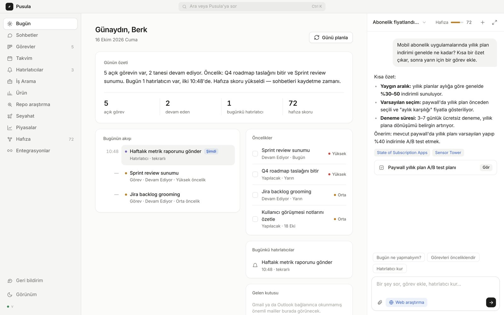
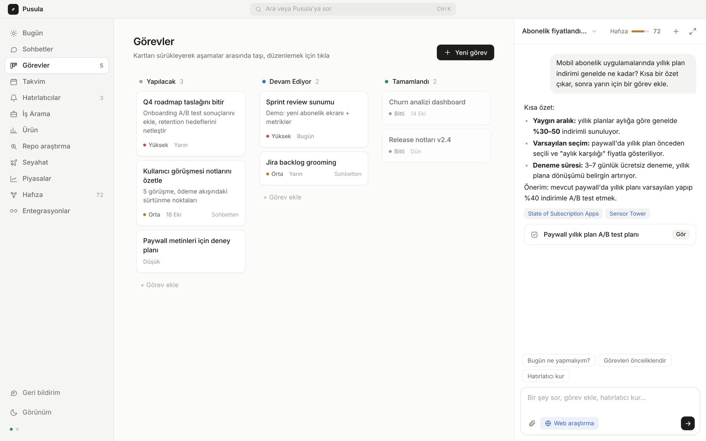
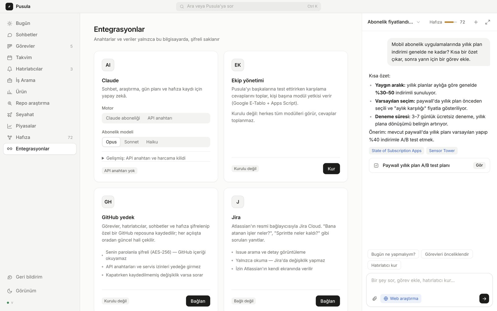

### Hi, I'm Berk 👋

**Product Manager · B2C mobile & subscription apps · builds with AI-assisted development**

I take products from problem to shipped: discovery, pricing, roadmap and the code itself. I use AI-assisted development to prototype quickly, validate ideas with real users and ship production software end to end.

---

### cvdrops · [www.cvdrops.com](https://www.cvdrops.com)

AI-powered, ATS-friendly CV builder in Turkish, English and German. A guided 13-step wizard, Claude-powered content suggestions, cover letters, an Apply Kit that tailors the CV to a job posting, and a free ATS score as the acquisition hook. One-time credit packs instead of a subscription.

`Next.js` `Supabase` `Claude API` `Vercel` `Gumroad`

| AI-assisted wizard | Free ATS score |
|---|---|
|  |  |

📄 **[Read the product case study](cvdrops.md)**: architecture, pricing model and why the ATS score is the lead magnet.

---

### Pusula · personal AI desktop assistant

An Electron + Claude desktop assistant: chat with streaming and web research, tasks and reminders, long-term memory, and file attachments (image, PDF, Word). Integrates with Google Calendar, Gmail, Slack, Jira and WhatsApp. Security-first: isolated app protocol, strict CSP, validated IPC, encrypted keys and an approval step before any write action. Shipped to test users with versioned in-app updates.

`Electron` `Claude API` `SQLite` `MCP`

| Task board | Integrations |
|---|---|
|  |  |

---

### Tutu Veteriner · [tutuveterinerklinigi.vercel.app](https://tutuveterinerklinigi.vercel.app/)

Mobile-first website for a veterinary clinic: services, contact and appointment requests.

---

Source code for cvdrops and Pusula is private. Screens use demo data. Happy to walk through the code in an interview.

[LinkedIn](https://www.linkedin.com/in/ahmet-berk-conker/) · [cvdrops.com](https://www.cvdrops.com)
