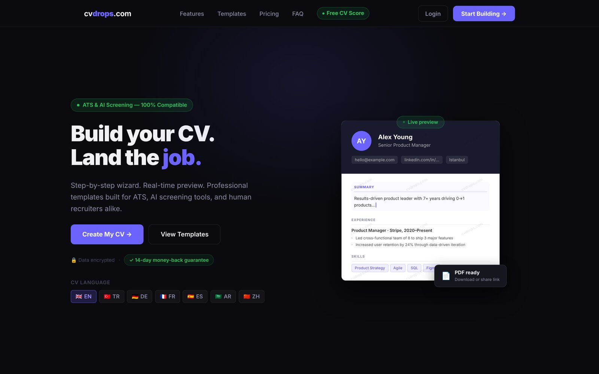
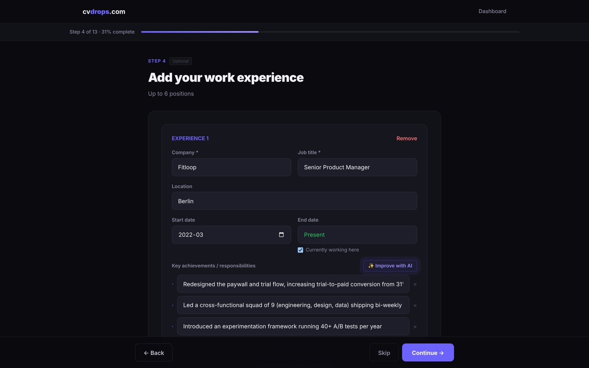
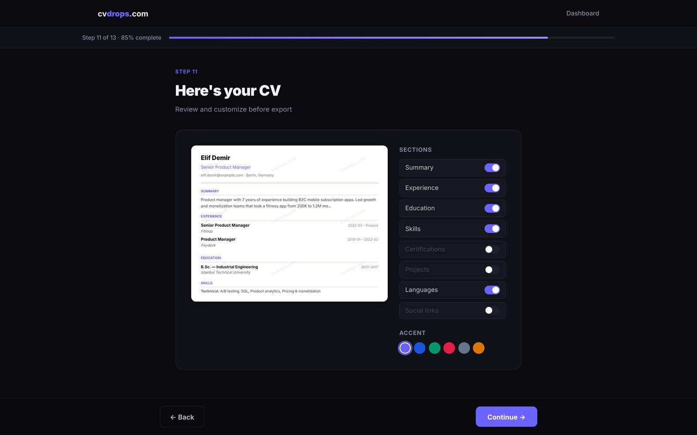
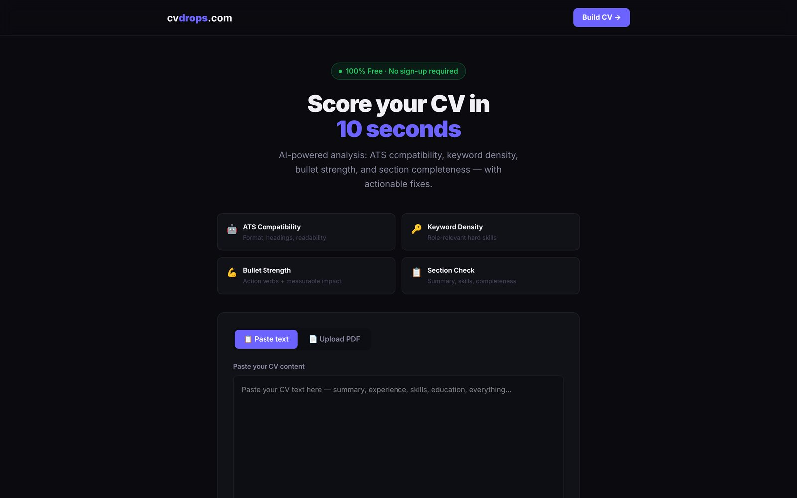

# cvdrops: product case study

**AI-powered, ATS-friendly CV builder in Turkish, English and German.**

🌐 Live: **[www.cvdrops.com](https://www.cvdrops.com)**



cvdrops helps job seekers turn their experience into a clean, ATS-parsable CV in minutes. A guided wizard collects the content, Claude suggests stronger wording, and the result exports as a PDF that applicant tracking systems can actually read. The first market is Turkish-speaking candidates applying in Germany, which is why the product runs in TR, EN and DE.

I designed, built and shipped it end to end as a product manager who codes: discovery, positioning, pricing, the product itself and go-to-market.

---

## Screens

| Wizard with AI suggestions | Live preview before export |
|---|---|
|  |  |

| Free ATS score (no sign-up) |
|---|
|  |

<sub>Screens show a fictional demo CV. The source code is private; happy to walk through it in an interview.</sub>

## Key features

| Feature | What it does |
|---|---|
| **Step-by-step wizard** | 13 short steps (goal, personal info, summary, experience, education, skills, certificates, languages, links, template, preview, export, cover letter). Progress autosaves; guests can start without signing up. |
| **AI content suggestions** | Rewrites summaries and experience bullets with action verbs and measurable outcomes, and suggests skills for the target role. |
| **Cover letter generation** | Writes a cover letter from the CV and an optional job description, in the CV's language. |
| **Apply Kit** | Paste a job posting and get a tailored CV plus a matching cover letter for that specific role. |
| **Free ATS score** | Upload or paste any CV at [`/cv-score`](https://www.cvdrops.com/cv-score) and get a score with concrete fixes. No account needed. |
| **ATS-safe PDF export** | Server-side rendered PDF with real, selectable text and a single-column layout that parsers handle well. |
| **Shareable link** | Each CV can be published as an expiring preview link. |
| **Localized landing pages** | `/`, `/tr` and `/de`, each with its own copy and SEO metadata. |

## Tech stack

- **Framework:** Next.js 16 (App Router, React 19, TypeScript)
- **Database and auth:** Supabase (Postgres, Row Level Security, Storage)
- **AI:** Anthropic Claude API
- **PDF:** headless Chromium (`@sparticuz/chromium` + `puppeteer-core`) on serverless
- **Payments:** Gumroad (webhook-driven credit top-ups)
- **Email:** Resend
- **Hosting:** Vercel, with Vercel Analytics and Speed Insights
- **CI:** GitHub Actions brand and route guards

## Architecture

```
Browser (Next.js App Router, Zustand wizard state)
   │
   ├── /build/[step]        13-step wizard, client state persisted per step
   ├── /cv-score            free ATS checker (public)
   └── /dashboard           saved CVs, cover letters, Apply Kit
   │
Next.js Route Handlers (/api/*, Vercel serverless)
   ├── /api/ai/*            summary, bullets, skills, cover letter  ──► Claude API
   ├── /api/cv-score        PDF text extraction + scoring            ──► Claude API
   ├── /api/cvs/[id]/*      PDF render, share link, Apply Kit        ──► Chromium
   └── /api/webhooks/gumroad  verifies sale, credits the user's balance
   │
Supabase
   ├── Auth (email + password)
   ├── Postgres: profiles, cvs, cv_content, user_credits, purchases (RLS)
   └── SQL functions for atomic deduct / refund of credits
```

A few decisions worth noting:

- **Credits are spent atomically in Postgres.** Deducting and refunding run as SQL functions, so two parallel requests cannot spend the same credit. If an AI call fails, the credit is refunded.
- **Paid endpoints check credits before calling Claude.** The free endpoints (ATS score, guest AI tries) are rate-limited per IP to keep API costs bounded.
- **The PDF is rendered from HTML with headless Chromium**, not a PDF drawing library. The same template drives the on-screen preview and the export, so what users see is what they download.
- **Secrets stay server-side.** Only the Supabase URL and anon key reach the browser; the service role key, Claude key and webhook secret are server environment variables.

## Product decisions

### Credit-based pricing instead of a subscription

Most CV builders lure users with a cheap trial that turns into a ~$20–25/month subscription. That model fits poorly with how people actually job hunt: intensely for a few weeks, then not at all. It also creates churn complaints and refund requests.

cvdrops sells one-time credit packs instead (Starter, Pro, Studio). Each action has a visible price: a PDF download, an AI rewrite, a cover letter, an Apply Kit. Why:

- **It matches the job.**Users pay for the applications they send, not for calendar time.
- **Trust as a differentiator.** "No subscription, no auto-renewal" is a clear message against the trial-trap competitors.
- **Margin per action.** Every credit maps to a known Claude API cost, so each pack stays profitable regardless of how heavily someone uses it.
- **Fits the price-sensitive first market**, where local competitors sell one-time packages.

The trade-off is less predictable revenue than MRR, which is acceptable at this stage in exchange for faster conversion and fewer refunds.

### Free ATS score as the lead magnet

The ATS checker is free, needs no account and works on any CV, not only ones built with cvdrops. Why:

- **It answers the question users already have:** "Will my CV get past the filter?" That question has search demand, while "CV builder" is dominated by large incumbents.
- **It shows the value before asking for anything.** The score comes with concrete fixes, and the natural next step is "fix it here."
- **It lowers the cost of acquisition.** The ATS score is a shareable, SEO-friendly entry point that does not depend on paid ads.
- **Cost is controlled** with per-IP rate limits and a single short Claude call per score.

Next steps on this funnel: email capture after the score and moving the checker into the homepage hero.

---

Built by **Ahmet Berk Conker**: [LinkedIn](https://www.linkedin.com/in/ahmet-berk-conker/)
